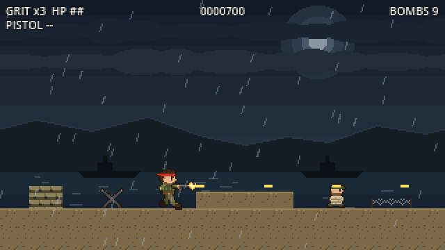
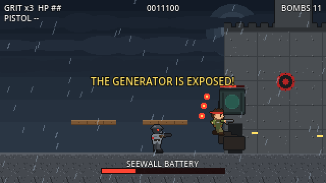

# Vanguard Ops: Kesselstadt Run

A Metal Slug style run-and-gun shooter, built in Godot 4. This is Game 1 of the planned Vanguard Ops trilogy.

1944, in an alternate, diesel-choked world. Sergeant "Grit" Calloway of the Allied Special Operations Vanguard is dropped behind enemy lines to fight through the Iron Directorate and bring Supreme Chancellor Vane to justice.

**Current goal:** one complete level, Mission 1 "Operation Breakwater" (a rain-slicked coastal bunker network), ending in a boss fight against the Seewall gun battery.



## Status

| Step | What | State |
| --- | --- | --- |
| 1 | Design doc | Done |
| 2 | Playable prototype with placeholder art | Done |
| 3 | Full Mission 1 in gray-box art, with the boss | Done |
| 4 | Final art, sound, menus and desktop builds | In progress: art done |

## Mission 1: Operation Breakwater

1. **Night drop:** Grit parachutes onto the beach in the storm.
2. **Beach obstacles:** sandbags, a dune and grenadiers; the first POW hands over the heavy machine gun.
3. **Trench line:** parapets, shield troopers and an MG nest. A POW is hidden in a dugout under a plank (Down + Jump).
4. **Artillery barrage:** flares mark where shells will land; mortar crews hold the bluff.
5. **Half-track ambush:** the camera locks and an armored half-track rolls in. Beat it for the rocket launcher.
6. **Bunker interior:** another MG nest, a POW on a high shelf, and a freight elevator up the cliff while troops drop in.
7. **Cliff top and boss:** checkpoint, then the Seewall battery in three phases: flak turrets, the main cannon (get up on the planks), and the exposed generator core. Every boss volley fires its fastest shot first and slowest last, so the shots arrive one at a time and each can be jumped.

Pick **Easy** (3 hits per life) or **Hard** (one hit, arcade rules) on the title screen.

Weapons drop as the gun itself. **Ammo boxes** refill Grit's special weapon, or bring back the last one he had if he's down to the pistol. Freed **POWs** drop a reward, then grab a rifle and fight beside Grit for up to 10 seconds.



## Running the game

1. Install [Godot 4.5](https://godotengine.org/download) (the standard build, not .NET).
2. Clone this repo. With GitHub Desktop it lands in `Documents/GitHub/grit-iron-directorate`.
3. Open Godot, click **Import**, and pick the `project.godot` file in that folder.
4. Press **F5** (or the Play button) to run.

## Controls

| Action | Keyboard | Gamepad |
| --- | --- | --- |
| Move | Arrow keys or A / D | Left stick or D-pad |
| Aim up | Up or W | Up |
| Crouch / aim down in the air | Down or S | Down |
| Jump (Down + Jump drops through planks) | Z or Space | A / Cross |
| Shoot (knife when an enemy is close) | X or J | X / Square |
| Grenade | C or K | B / Circle |
| Pause (then Grenade: restart from checkpoint, Jump: quit to title) | Esc or P | Start |
| Fullscreen | F11 | |

## Project layout

```
project.godot             Engine settings (320x180 pixel-perfect, integer scaling)
scripts/autoload/game.gd  Global state: score, lives, difficulty, checkpoint, stats, input bindings
scripts/player/           Grit: movement, parachute, aiming, 5 weapons, knife, grenades, health
scripts/enemies/          Rifleman, grenadier, shield trooper, mortar crew, MG nest, half-track
scripts/bosses/           Seewall battery boss and its destructible parts
scripts/projectiles/      Bullets (incl. shotgun pellets, flames, flak, cannon shell), grenades, rockets
scripts/fx/               Explosions, artillery strikes, rain
scripts/pickups/          Weapon and grenade crates, POW prisoners
scripts/camera/           Forward-only camera with vertical follow, arena locks and screen shake
scripts/level/            Textured blocks, props, triggers, elevator, checkpoint, mission root
scripts/ui/               Title screen, HUD, pause, game over and results screens
scenes/levels/mission1.tscn  Operation Breakwater
assets/sprites/           Generated sprite sheets, tiles and backdrops (do not edit by hand)
tools/art/                Python scripts that draw all the pixel art
tests/                    End-to-end mission test and screenshot tour
```

## Art

All pixel art is drawn by Python scripts in `tools/art/` (needs Pillow). Each sprite is a text grid, one character per pixel, with a palette per character set. Grit, the troopers and the POWs share a leg rig, so new poses are a few numbers. To change any art, edit the script and rebuild:

```
python3 tools/art/build.py
```

That rewrites everything in `assets/sprites/`. Open the project in Godot afterwards so it re-imports the changed images.

| Script | Draws |
| --- | --- |
| `grit.py` | Grit's body poses, the arm with each weapon at five aim angles, parachute, muzzle flash |
| `trooper.py` | Rifleman, grenadier, shield trooper, mortar crew (plus white hit-flash copies) |
| `vehicles.py` | MG nest, half-track |
| `pow.py` | POW prisoners |
| `boss.py` | Seewall battery wall, cannon, turrets, breech and core |
| `world.py` | Ground surfaces, props, storm sky, far cliffs and fleet, bunker walls |
| `fx.py` | Explosion animation |


## Tests

A bot plays all of Mission 1, from the parachute drop to the boss, and checks every beat: checkpoint, elevator, arena locks, the half-track, weapon pickups, mortars, all boss phases, mission complete and the results screen. It also checks Easy mode's 3 hits per life.

```
godot --headless --fixed-fps 60 res://tests/mission_test.tscn
```

It prints `MISSION TEST PASSED` and exits with code 0, or lists what failed and exits with code 1. GitHub runs it on every push and pull request.

To capture a screenshot at each beat (needs a display):

```
godot --fixed-fps 60 res://tests/screenshot_tour.tscn -- /path/to/output
```
